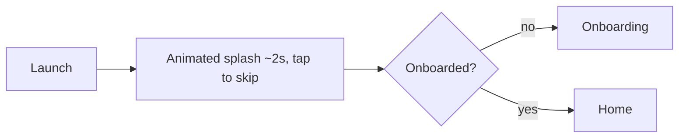
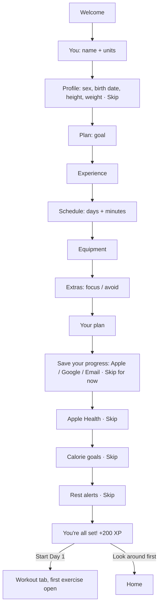
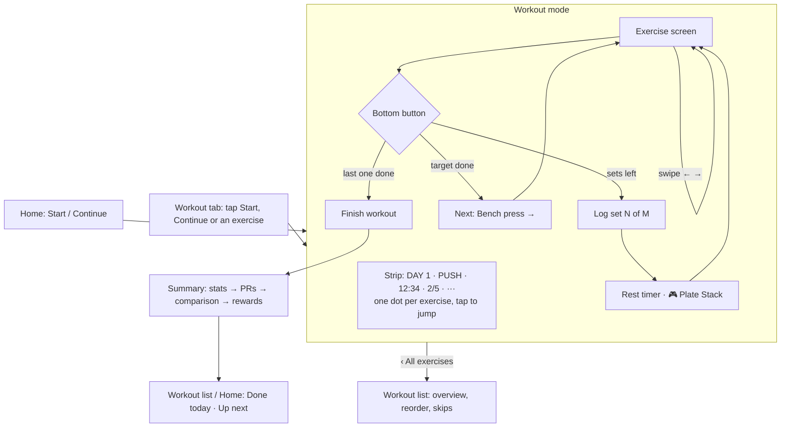
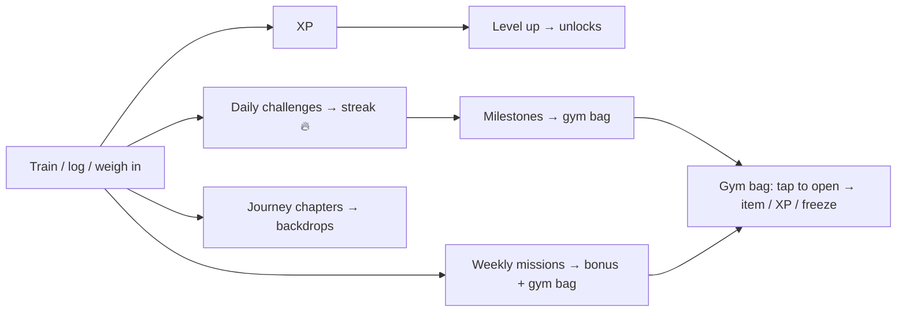

# PixyPump UX flows

How people move through the app, and the rules every screen follows. Update this file in the same pull
request whenever you change a flow.

## UX rules

1. **One job per screen.** One primary button (`.buttonStyle(.primary)`); everything else is secondary.
2. **Training first, game second.** Rewards decorate the core loop (log sets, finish, eat, weigh in); they never block it.
3. **One big moment at a time.** Summary, level-up and gym-bag reveals never stack (`MomentQueue`). No surprise full-screen pop-ups: bags open only when tapped.
4. **Everything is undoable.** Deletes and logs show an Undo toast; big deletes ask first.
5. **Nothing hidden.** Every action has a visible control. Long-press and swipe are shortcuts, never the only way.
6. **Accounts are optional.** The app works fully offline; signing in never touches data on the phone.
7. **New users see less.** Weekly missions and Journey appear after the first workout.
8. **Today is clear.** One workout at a time: while training, other days are previews. After finishing, Home and Workout say what's done today and what's next ("Up next").
9. **Same words everywhere.** See `COPY.md`.
10. **Home is just today.** One big workout card, three small tiles (calories left, weight, challenges) and at most
    one reminder (gym bag → first-week checklist → backup → save progress). Week-scale things (weekly missions,
    Journey, this week's stats) live at the top of Progress. Don't add new cards to Home; add a tile only if it's
    something people check every day.

## App start

## Onboarding (12–13 screens)

## Core loop: a workout (workout mode)

**Rules**

- **One button, one place.** The bottom button always does the next thing: *Log set N of M* → *Next: X* → *Finish workout*.
  It's briefly disabled right after a set so a double tap can't jump ahead.
- **Never two big buttons.** Once the target is done the set card closes. "+ Add an extra set" (a quiet link) opens it
  again and the bottom button becomes *Log extra set* until it's logged (or Cancel). "Finish exercise" is a quiet link too.
- **Always know where you are.** The strip at the top shows the day, the timer, how many are done, and a dot per exercise
  (✓ done, filled = on screen). Tap a dot or swipe sideways to move. Back is labelled "All exercises".
- **Today is locked while training.** Once a workout is in progress, only that day can be logged. Other days open as a
  **preview** (plan + history, no logging) with "Back to today". Before starting, any day can be opened; the first set starts it.
- **After finishing,** every day is a preview. Today's day offers "Add more sets" for a forgotten set.
- **Logging happens only in workout mode.** Exercise screens opened from Progress or History are read-only.
- **Ending early** (Finish workout early / Cancel workout) lives in the strip's ··· menu, with Skip and Swap for the
  exercise on screen. Skip shows Undo and moves on.
- **Reps are one tap:** chips for the plan's range (8–10 → 8 9 10), −/+ for anything else.
- **Weight −/+ fits the equipment:** barbell 2.5 kg, dumbbells 2 kg, machines 5 kg (5 / 5 / 10 lb). Guessed from the name (`ExerciseKind`).
- **Rest fits the exercise:** big lifts rest 1 min longer than the Settings length, small moves 30 s shorter.
  +30 / −30 during a rest is remembered for that exercise (`RestPlan`). × stops the timer, with Undo.
- **First time in workout mode,** a tips card explains the dots, swiping and the bottom button (shown once).
- Exercise order is the plan's, wrapping round to ones skipped past. "Reorder today" changes it for today only.
- Skip / swap / finish early are per-day; the plan itself only changes in the plan editor.
- "Finish exercise" lets you stop with fewer sets than planned (today only).

## Daily habits

- **Food:** Calories tab → **+** (meal picked by time of day) → search / scan / quick add → log. Undo on delete.
- **Weight:** Home → weight tile → save (also under Progress → Body weight).
- **Streak:** a day counts when you train **or** win a daily challenge. Freezes ❄️ save a missed day.

## Rewards

Explained to players in **How rewards work** (tap the XP bar on Home).

## Account

- Entry points: onboarding step, Home reminder card (after first workout or 3-day streak, closable), Settings → Account.
- Same buttons for sign up and sign in: Apple, Google, Email (6-digit code, no passwords).
- Settings → Account: sign out (keeps phone data), delete account (optionally also phone data).

## Settings map

Account · Profile · Training · Food · Look & Buddy (buddy, Appearance, sounds, haptics) · Notifications ·
Data & privacy (backup, export, delete) · About · Developer (Debug only).
Appearance: Colours (theme packs, accent, background, headings) · Your stuff (app icon, banner, XP bar,
rest timer, plates, confetti) · Feel (celebrations).

## Pro (paywall)

- Opened only by the person: Settings → "Get PixyPump Pro", or the Appearance banner. No pop-ups, no timers.
- One screen: what Pro adds → three plans (yearly selected) → one button → the terms in plain words.
- The button says exactly what happens ("Start 7-day free trial", "Subscribe", "Buy lifetime").
- Already Pro: the same sheet shows "You're Pro" with Manage subscription.
